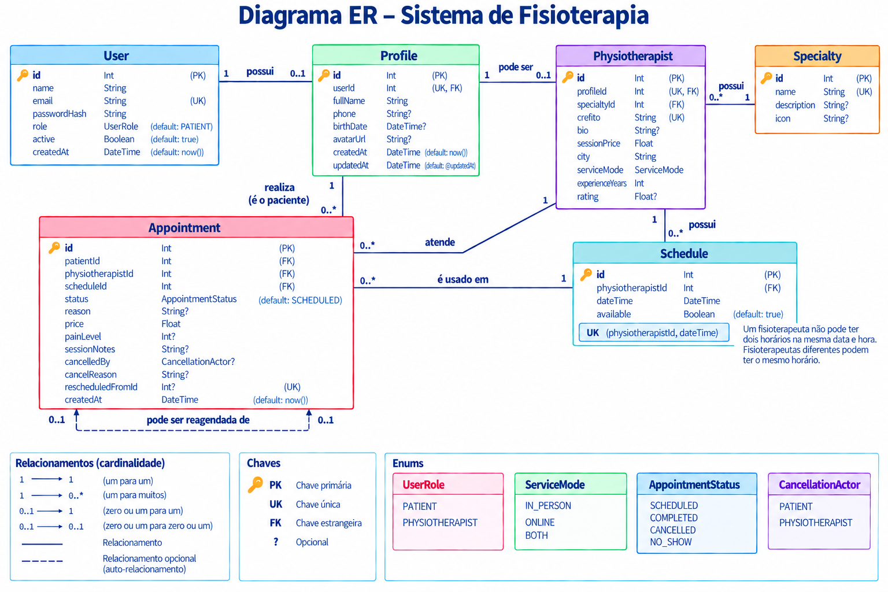

# 4Ward — API de Gestão de Consultas para Fisioterapeutas

API desenvolvida para uma aplicação que conecta **pacientes e fisioterapeutas**.

O sistema permite que fisioterapeutas cadastrem seus dados profissionais e horários disponíveis, enquanto pacientes podem encontrar profissionais, consultar horários e realizar agendamentos.

Também é possível cancelar, remarcar e acompanhar o status das consultas.

## Equipe

Projeto desenvolvido por:

- Alberto Neto
- Gabriel Trentini
- Wesley Triches

---

## Tecnologias

- Node.js
- TypeScript
- NestJS
- Prisma ORM
- SQLite
- JWT
- bcryptjs
- class-validator
- class-transformer
- @nestjs/config

---

## Como executar

### 1. Clonar o repositório

```bash
git clone https://github.com/WesleyTriches/4Ward.git
cd 4Ward
```

### 2. Instalar as dependências

```bash
npm install
```

### 3. Criar o arquivo `.env`

Na raiz do projeto:

```env
DATABASE_URL="file:./dev.db"
JWT_SECRET="troque-por-uma-frase-secreta-grande"
```

### 4. Preparar o banco de dados

```bash
npx prisma migrate dev
npx prisma generate
```

### 5. Iniciar a API

```bash
npm run start:dev
```

A API ficará disponível em:

```text
http://localhost:3000/api
```

---

## Autenticação

A API utiliza autenticação por **JWT (JSON Web Token)**.

As seguintes rotas são públicas:

```text
POST /auth/register
POST /auth/login
POST /auth/reactivate
```

As demais rotas exigem:

```http
Authorization: Bearer <access_token>
```

Após o cadastro ou login, a API retorna um `access_token`.

O JWT contém informações como:

- ID do usuário (`sub`);
- nome;
- email;
- papel do usuário.

Papéis disponíveis:

```text
PATIENT
PHYSIOTHERAPIST
```

O token possui validade de **1 dia**.

---

## Cadastro de usuários

### Paciente

O paciente se registra utilizando:

```http
POST /auth/register
```

Exemplo:

```json
{
  "name": "Maria",
  "email": "maria@email.com",
  "password": "123456",
  "role": "PATIENT"
}
```

O cadastro cria:

```text
User
 └── Profile
```

Depois disso, o paciente pode procurar fisioterapeutas e realizar agendamentos.

### Fisioterapeuta

O fisioterapeuta também utiliza:

```http
POST /auth/register
```

Exemplo:

```json
{
  "name": "Paulo",
  "email": "paulo@fisio.com",
  "password": "123456",
  "role": "PHYSIOTHERAPIST"
}
```

O cadastro cria:

```text
User
 └── Profile
```

Depois, o fisioterapeuta cadastra seus dados profissionais através de:

```http
POST /physiotherapists
```

Assim, a estrutura fica:

```text
User
 └── Profile
      └── Physiotherapist
```

---

## Fluxo da aplicação

### Paciente

1. Realiza o cadastro;
2. recebe um token JWT;
3. procura fisioterapeutas;
4. consulta horários disponíveis;
5. agenda uma consulta;
6. visualiza suas consultas;
7. pode cancelar ou remarcar quando permitido.

### Fisioterapeuta

1. Realiza o cadastro como `PHYSIOTHERAPIST`;
2. recebe um token JWT;
3. cadastra seus dados profissionais;
4. cadastra horários disponíveis;
5. visualiza sua agenda;
6. acompanha suas consultas;
7. pode cancelar consultas;
8. após o atendimento, registra a consulta como realizada ou falta.

---

# Rotas

Todas as rotas possuem o prefixo:

```text
/api
```

Exemplo:

```text
http://localhost:3000/api/auth/login
```

## Autenticação

| Método | Rota | Descrição |
|---|---|---|
| POST | `/auth/register` | Cadastra um usuário |
| POST | `/auth/login` | Realiza login |
| POST | `/auth/reactivate` | Reativa uma conta |

---

## Usuários

| Método | Rota | Descrição |
|---|---|---|
| PUT | `/users/me` | Atualiza nome e email |
| PUT | `/users/me/deactivate` | Desativa a conta |

O usuário autenticado é identificado pelo JWT através de:

```ts
req.user.sub
```

Por isso, não é necessário enviar o ID do usuário nas rotas relacionadas à própria conta.

### Desativação

A conta não é excluída do banco.

O campo:

```text
active
```

passa de:

```text
true
```

para:

```text
false
```

Usuários desativados não conseguem acessar as rotas protegidas nem realizar login.

Para reativar:

```http
POST /auth/reactivate
```

Exemplo:

```json
{
  "email": "usuario@email.com",
  "password": "123456"
}
```

---

## Perfis

| Método | Rota | Descrição |
|---|---|---|
| GET | `/profiles/me` | Retorna o perfil do usuário |
| PUT | `/profiles/me` | Atualiza o perfil |

O `Profile` é criado automaticamente durante o cadastro do usuário.

Ele pode armazenar informações como:

- nome completo;
- telefone;
- data de nascimento;
- avatar.

---

## Especialidades

| Método | Rota | Descrição |
|---|---|---|
| POST | `/specialties` | Cria uma especialidade |
| GET | `/specialties` | Lista especialidades |
| GET | `/specialties/:id` | Busca uma especialidade |
| PUT | `/specialties/:id` | Atualiza uma especialidade |

Criação e atualização são permitidas somente para fisioterapeutas.

Não existe exclusão de especialidades para evitar problemas com registros já vinculados.

---

## Fisioterapeutas

| Método | Rota | Descrição |
|---|---|---|
| POST | `/physiotherapists` | Cria o perfil profissional |
| GET | `/physiotherapists` | Lista fisioterapeutas |
| GET | `/physiotherapists/me` | Retorna o perfil profissional do usuário |
| PUT | `/physiotherapists/me` | Atualiza o perfil profissional |
| GET | `/physiotherapists/:id` | Busca um fisioterapeuta |

Para criar um perfil profissional, o usuário precisa possuir o papel:

```text
PHYSIOTHERAPIST
```

Exemplo:

```json
{
  "specialtyId": 1,
  "crefito": "123456-F",
  "bio": "Atendimento voltado à reabilitação esportiva",
  "sessionPrice": 150,
  "city": "Marau",
  "serviceMode": "IN_PERSON",
  "experienceYears": 5
}
```

O usuário não precisa informar `userId` nem `profileId`.

O backend identifica o usuário através do JWT e encontra seu `Profile`.

### Meu perfil profissional

```http
GET /physiotherapists/me
```

Retorna o perfil profissional do usuário logado, com `specialty` e `profile`.

Se o fisioterapeuta ainda não completou o cadastro profissional, a rota retorna `404`.

Para atualizar, basta enviar apenas os campos que serão alterados:

```http
PUT /physiotherapists/me
```

```json
{
  "bio": "Atendimento voltado à reabilitação esportiva e ergonomia",
  "sessionPrice": 180,
  "serviceMode": "BOTH"
}
```

As mesmas regras da criação são aplicadas:

- a especialidade informada precisa existir (`404`);
- o CREFITO não pode pertencer a outro fisioterapeuta (`409`).

### Filtros

Por cidade:

```http
GET /physiotherapists?city=Marau
```

Por especialidade:

```http
GET /physiotherapists?specialtyId=1
```

Por modalidade:

```http
GET /physiotherapists?serviceMode=IN_PERSON
```

Os filtros podem ser combinados:

```http
GET /physiotherapists?city=Marau&specialtyId=1&serviceMode=IN_PERSON
```

Modalidades disponíveis:

```text
IN_PERSON
ONLINE
BOTH
```

---

## Horários

| Método | Rota | Descrição |
|---|---|---|
| POST | `/schedules` | Cria um horário |
| GET | `/schedules` | Lista horários disponíveis |
| GET | `/schedules/me` | Retorna a agenda do fisioterapeuta |

Criar horário:

```json
{
  "dateTime": "2026-10-25T14:00:00Z"
}
```

Consultar horários de um fisioterapeuta:

```http
GET /schedules?physiotherapistId=1
```

Filtrar por data:

```http
GET /schedules?physiotherapistId=1&date=2026-10-25
```

Consultar a própria agenda:

```http
GET /schedules/me
```

Ou por data:

```http
GET /schedules/me?date=2026-10-25
```

### Regras

- Não é possível cadastrar horários no passado;
- um fisioterapeuta não pode possuir dois horários na mesma data e hora;
- fisioterapeutas diferentes podem disponibilizar o mesmo horário.

---

## Consultas

| Método | Rota | Descrição |
|---|---|---|
| POST | `/appointments` | Agenda uma consulta |
| GET | `/appointments/me` | Lista minhas consultas |
| GET | `/appointments/:id` | Busca uma consulta |
| PATCH | `/appointments/:id/cancel` | Cancela uma consulta |
| POST | `/appointments/:id/reschedule` | Remarca uma consulta |
| PATCH | `/appointments/:id/complete` | Marca como realizada |
| PATCH | `/appointments/:id/no-show` | Registra falta |

### Agendar

Apenas pacientes podem criar consultas.

```http
POST /appointments
```

O agendamento utiliza um horário disponível.

### Filtrar por status

```http
GET /appointments/me?status=SCHEDULED
```

Status disponíveis:

```text
SCHEDULED
COMPLETED
CANCELLED
NO_SHOW
```

### Cancelar

```http
PATCH /appointments/:id/cancel
```

Exemplo:

```json
{
  "cancelReason": "Não poderei comparecer."
}
```

### Remarcar

```http
POST /appointments/:id/reschedule
```

Exemplo:

```json
{
  "newScheduleId": 10
}
```

### Finalizar consulta

```http
PATCH /appointments/:id/complete
```

Pode receber:

```json
{
  "sessionNotes": "Paciente apresentou melhora."
}
```

### Registrar falta

```http
PATCH /appointments/:id/no-show
```

Somente o fisioterapeuta da consulta pode utilizar essa operação.

---

## Principais regras de negócio

- Apenas pacientes podem agendar consultas;
- não é possível agendar horários que já passaram;
- um horário pode possuir apenas uma consulta ativa por vez;
- ao criar uma consulta, o horário fica indisponível;
- ao cancelar ou remarcar, o horário anterior volta a ficar disponível;
- o agendamento utiliza transação para impedir que dois pacientes ocupem o mesmo horário;
- um paciente não pode possuir duas consultas agendadas na mesma data e hora;
- o preço da consulta é registrado no momento do agendamento;
- alterações futuras no preço do fisioterapeuta não modificam consultas já agendadas;
- cada usuário só pode acessar consultas das quais participa;
- pacientes só podem cancelar ou remarcar com pelo menos 24 horas de antecedência;
- fisioterapeutas podem cancelar antes do horário sem a regra das 24 horas;
- consultas passadas não podem ser canceladas ou remarcadas;
- após o horário, o fisioterapeuta pode marcar a consulta como `COMPLETED` ou `NO_SHOW`;
- consultas em estado final não podem mais ser alteradas;
- ao remarcar, a consulta anterior permanece no histórico como `CANCELLED`;
- o novo horário de uma remarcação deve pertencer ao mesmo fisioterapeuta.

---

## Principais entidades

### User

Representa a conta utilizada para autenticação.

Principais informações:

- nome;
- email;
- senha armazenada como hash;
- papel;
- situação da conta.

### Profile

Armazena os dados pessoais do usuário.

```text
User 1 — 1 Profile
```

### Physiotherapist

Armazena informações profissionais:

- CREFITO;
- especialidade;
- biografia;
- preço;
- cidade;
- modalidade;
- experiência.

Um fisioterapeuta está relacionado a um `Profile`.

### Specialty

Representa uma especialidade profissional.

### Schedule

Representa um horário disponibilizado por um fisioterapeuta.

### Appointment

Representa uma consulta entre paciente e fisioterapeuta.

Um `Schedule` pode possuir várias consultas armazenadas no histórico, mas somente uma consulta pode estar ativa por vez.

---

## Enums

### UserRole

```text
PATIENT
PHYSIOTHERAPIST
```

### ServiceMode

```text
IN_PERSON
ONLINE
BOTH
```

### AppointmentStatus

```text
SCHEDULED
COMPLETED
CANCELLED
NO_SHOW
```

### CancellationActor

```text
PATIENT
PHYSIOTHERAPIST
```

---

## Modelo simplificado

```text
User
 │
 └── Profile
      │
      ├── Physiotherapist
      │     │
      │     ├── Specialty
      │     ├── Schedule
      │     └── Appointment
      │
      └── Appointment
```

---

## Diagrama ER


